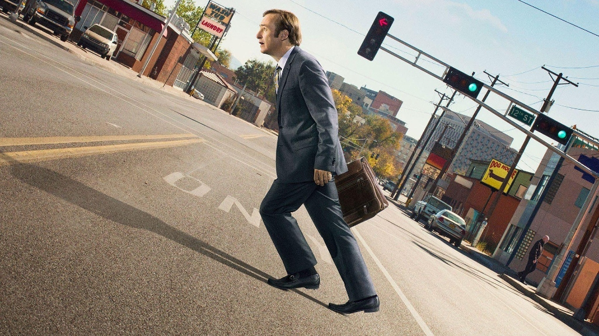

# HomeOS 🖥️

A simple, fast, and elegant vanilla JavaScript webapp and Progressive Web App (PWA) designed with a floating metallic frosted glass dock and desktop background.



---

## ✨ Features

- **Custom Wallpaper**: Uses your uploaded *Better Call Saul* street slant artwork as the full-bleed responsive background.
- **Floating Frosted Glass See-Through Dock**:
  - Located at bottom-center with a compact, refined profile.
  - **See-through but blurry glass aesthetics**: High transparency (`rgba(255, 255, 255, 0.16)` gradient) with heavy optical blur (`backdrop-filter: blur(28px) saturate(140%)`), letting the background wallpaper show through with real frosty depth.
  - Delicate top glass rim highlight and soft ambient floating shadow.
  - Clean edge with no indicator dots.
- **Authentic Official Brand Icons (Full Color)**:
  - Custom high-resolution assets (1254×1254px):
    1. 🍿 **Netflix** (`netflix-512.png`)
    2. 🎬 **Amazon Prime Video** (`prime-512.png`)
    3. ⭐ **JioHotstar** (`jiohotstar-512.png`)
    4. 🌈 **ZEE5** (`zee5-512.png`)
    5. 📺 **Sony LIV** (`sony-512.png`)
    6. 🍎 **Apple TV** (`apple-512.png`)
    7. 🏏 **FanCode** (`fancode-512.png`)
    8. 🎵 **YouTube Music** (`ytmusic-512.png`)
    9. ▶️ **YouTube** (`youtube-512.png`)
    10. 🦁 **Brave Browser** (`brave-512.png`)
- **macOS-Style Dock Physics**:
  - Continuous bell-curve icon magnification on mouse proximity.
  - Spring-loaded launch bounce animation on click with active glowing indicator dots.
  - Frosted glass tooltips displaying app names on hover.
- **Progressive Web App (PWA) Ready**:
  - Offline asset caching with Service Worker (`sw.js`).
  - Standalone app manifest (`manifest.json`) and high-res icons (192px and 512px).
  - Can be installed directly to your desktop or mobile home screen as a native-like app.
- **Desktop Extras**:
  - **Live Clock & Calendar Widget** (Top-left frosted pill).
  - **Spotlight Search** (Press `/` or click Search to quickly search and launch apps with arrow keys + Enter).
  - **Clean Mode** (Press `H` or click the eye icon to hide the UI and admire the wallpaper; click anywhere to restore).
  - **Fullscreen Toggle** (Press `F` or click fullscreen icon).

---

## 🚀 Running Locally

The local server is already running at:
**[http://localhost:8085](http://localhost:8085)**

You can also start it at any time using:
```bash
npm start
```
or by double-clicking `start.bat`.

---

## 📱 How to Install as a PWA / Fullscreen Mode

1. Open **[http://localhost:8085](http://localhost:8085)** in **Google Chrome**, **Brave**, or **Microsoft Edge**.
2. Click the **"Install App"** pill in the top-right corner of the status bar, or click the **Install icon** in the browser's address bar (`Install HomeOS`).
3. HomeOS will launch in its own standalone window without browser address bars or tabs!

### 📺 Persistent Fullscreen (TV / Media Center Mode)
- **Keyboard Shortcut:** Press **`F11`** inside the app window. Unlike the web button (which resets on page navigation), `F11` sets **Window-Level Fullscreen** that stays active across all sites (Netflix, YouTube, Prime, etc.) and hides all title bars and navigation strips.
- **1-Click Fullscreen Launcher:** Double-click [`launch-homeos-fullscreen.bat`](file:///f:/Antigravity/HomeOS/launch-homeos-fullscreen.bat) in the project folder to start HomeOS automatically in chromeless fullscreen mode.

